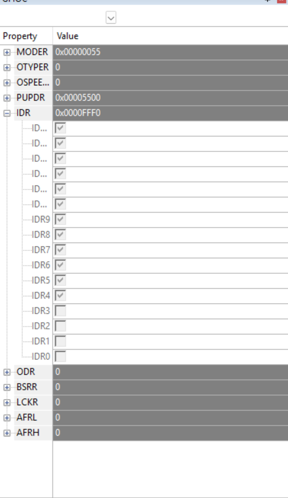
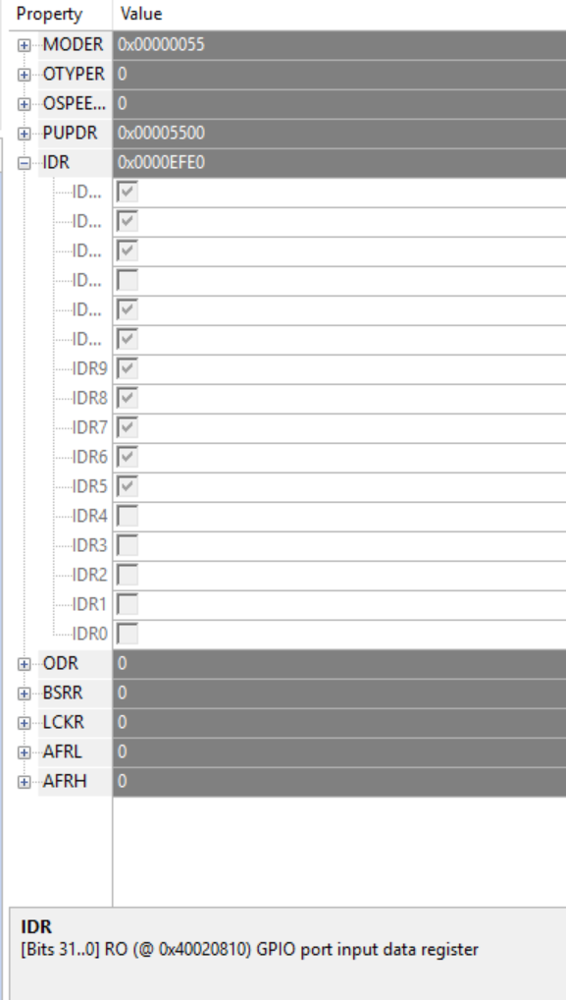
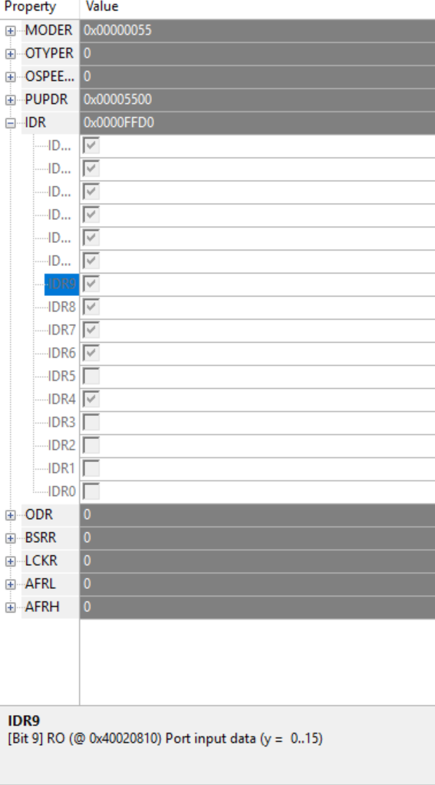
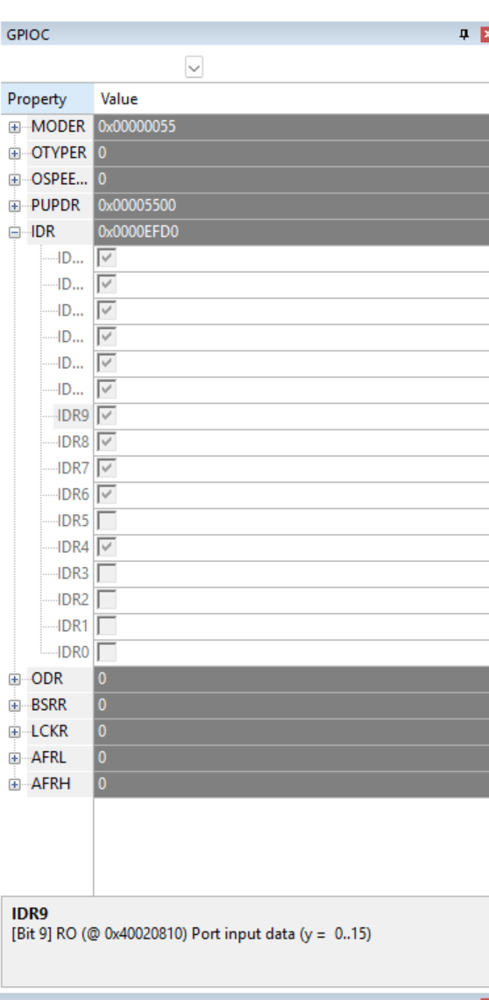

# VaultLink

**A Wi-Fi connected, multi-user keypad lock box for the STM32F401RE, written entirely in ARM assembly.**

ESET 349 (Microcontroller Architecture) final project, Texas A&M University, Fall 2026.

> **Status: in progress.** The keypad is fully read on the board: key presses are scanned,
> decoded, debounced, built into a 4-digit PIN, and checked against
> a table of owner and user PINs.
> See [Progress](#progress) for what works today and what is still to come.

---

## What it does

VaultLink is a lock box that protects its contents with personal PIN codes and reports what happens to its owner's phone.

- Each user has their own 4–6 digit PIN, stored as a hash rather than the digits themselves.
- A correct PIN moves a servo that releases the latch; the box re-locks itself when the lid closes.
- Three wrong PINs lock the keypad out for 30 s, then 60 s, then 120 s.
- Opening the lid while the box is locked sets off an alarm.
- An admin user can add or remove users and view an access log from the keypad.
- Over Wi-Fi, the owner gets a phone notification for every unlock, lockout, or tamper alarm, and can unlock the box remotely.

The lock is designed to work fully without Wi-Fi; the wireless features are an extra layer on top.

## Progress

| Area | Status |
|---|---|
| Keypad wiring mapped and verified | ✅ Done |
| GPIOC configured for the keypad (clock, modes, pull-ups) | ✅ Verified on hardware |
| Row scan loop | ✅ Verified on hardware |
| Key decoding (row and column → key number → ASCII character) | ✅ Verified on hardware |
| Debounce (wait for release, then a 15 ms bounce delay) | ✅ Verified on hardware |
| PIN entry (4 digits in RAM, `*` clears, other keys ignored, overflow-safe) | ✅ Verified on hardware |
| User table (owner/user roles) and PIN check, attempt counter | ✅ Verified on hardware |
| Lock states: keypad by state, `#` to lock, lockout | ⬜ Next |
| 16×2 LCD output | ⬜ Planned |
| Lock logic (PINs, lockout, re-lock) | ⬜ Planned |
| Servo latch, buzzer, status LEDs | ⬜ Planned |
| Lid sensor and tamper alarm | ⬜ Planned |
| Admin menu and access log | ⬜ Planned |
| Wi-Fi alerts and remote unlock (ESP-01) | ⬜ Planned (extra credit) |

## Hardware

| Part | Purpose |
|---|---|
| STM32F401RE Nucleo-64 | Main controller |
| 4×4 membrane keypad | PIN entry and menu |
| 16×2 character LCD (HD44780) | Prompts and status |
| SG90 micro servo | Latch |
| Passive piezo buzzer | Key clicks, tones, alarm |
| Red and green LEDs (330 Ω resistors) | Locked / unlocked status |
| MC-38 magnetic reed switch | Lid open / closed |
| ESP-01 (ESP8266) + 3.3 V regulator | Wi-Fi |

## Pin map

| Port | Pins | Connected to |
|---|---|---|
| GPIOA | PA0 | Buzzer (TIM2 CH1 PWM) |
| | PA1, PA8 | Red / green status LEDs |
| | PA4, PA9, PA10 | ESP-01 reset, TX, RX (USART1) |
| | PA6 | Servo signal (TIM3 CH1 PWM) |
| GPIOB | PB0–PB10 | LCD data D0–D7 and RS, RW, E (planned) |
| | PB12 | Lid reed switch (interrupt) |
| GPIOC | PC0–PC3 | Keypad rows 1–4 |
| | PC4–PC7 | Keypad columns 1–4 |

Avoided on purpose: **PA2/PA3** (USB serial to the PC), **PA5** (on-board LED), **PA13/PA14** (debugger).

## How the keypad is read

A matrix keypad's 16 keys sit where 4 row wires cross 4 column wires; pressing a key connects one row to one column.

| Ribbon pin | 1 | 2 | 3 | 4 | 5 | 6 | 7 | 8 |
|---|---|---|---|---|---|---|---|---|
| Wire | Row 1 | Row 2 | Row 3 | Row 4 | Col 1 | Col 2 | Col 3 | Col 4 |
| STM32 pin | PC0 | PC1 | PC2 | PC3 | PC4 | PC5 | PC6 | PC7 |

The columns are inputs with internal pull-ups, so they read **1** when nothing is pressed. The program drives **one row low at a time** and reads the columns. A column only reads **0** when a key on the row currently being driven low is pressed, so the active row gives the key's row and the column that reads 0 gives its column.

**Why one row at a time:** with every row driven low, all keys in the same column look identical. Holding `2` or `5` pulls the same bit low:

| No key pressed | Holding `1` | Holding `2` | Holding `5` |
|---|---|---|---|
|  |  |  |  |

*GPIOC input register in Keil's System Viewer with all rows low: `1` clears IDR4 (column 1); `2` and `5` both clear IDR5 (column 2).*

The scan drives these row patterns in turn, stored in a lookup table:

| Row driven low | PC3–PC0 | Hex |
|---|---|---|
| Row 1 | 1110 | 0xE |
| Row 2 | 1101 | 0xD |
| Row 3 | 1011 | 0xB |
| Row 4 | 0111 | 0x7 |

## Building and running

1. Open `Code/Keypad_Logic/Keypad_Logic.uvprojx` in **Keil µVision 5** (MDK, Arm Compiler 6).
2. Under **Options for Target → Debug**, select **ST-Link Debugger** (not the simulator).
3. Build (**F7**), then start a debug session (**Ctrl+F5**) to flash the board.
4. Open **Peripherals → System Viewer → GPIO → GPIOC** to watch the keypad inputs live.

## Documentation

- [Design decisions](Documentation/design-decisions.md): every design choice and the reasoning behind it
- [Pin map and test log](Documentation/pinout.md)

## Repository layout

```
Code/Keypad_Logic/   Keil project and assembly source
Documentation/       Design decisions, pin map, test log, project plan, screenshots
```

## Authors

- Angel Lopez
